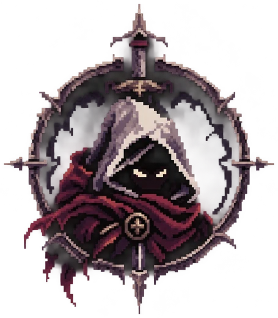

<p align="center">
  
</p>

<h1 align="center">ASHENFALL</h1>

<p align="center"><em>Apunta. Dispara. Sobrevive.</em></p>

<p align="center">
  <a href="https://ashenfall-server-prod.icytree-9cfd11e3.canadacentral.azurecontainerapps.io"><b>▶ Jugar ahora</b></a>
  &nbsp;·&nbsp;
  <a href="docs/jugar-en-local.md">Jugar en local</a>
  &nbsp;·&nbsp;
  <a href="https://ashenfall-server-prod.icytree-9cfd11e3.canadacentral.azurecontainerapps.io/docs">API</a>
</p>

Duelo 1v1 por turnos de proyectiles, de fantasía oscura y pixel art, que se juega en el navegador. Enlace para jugar: **<https://ashenfall-server-prod.icytree-9cfd11e3.canadacentral.azurecontainerapps.io>**. Solo hace falta crear una cuenta.

## La historia

Hace siglos, el mundo quedó dividido por un acontecimiento conocido como **La Caída de las Cenizas**.

Desde entonces, las antiguas tierras dejaron de ser seguras. Criaturas que habitaban las profundidades comenzaron a aparecer en los bosques, las montañas y los pueblos abandonados.

Los reinos cayeron. Los caminos quedaron desiertos. Y los pocos que todavía se atrevían a recorrerlos terminaron convirtiéndose en cazadores, mercenarios o monstruos.

En medio de ese mundo existe **Ashenfall**, un pequeño asentamiento comercial donde todavía se reúnen guerreros de todas las regiones.

Allí se reparan armas, se intercambian reliquias y se aceptan desafíos.

Porque en estas tierras, la supervivencia tiene un precio. Y la gloria pertenece a quien consigue regresar.

## Cómo jugar

### El objetivo
Cada duelo enfrenta a dos mercenarios en una arena. Se turnan para disparar; quien deja al rival sin vida gana. Cada uno empieza con **100 puntos de vida**, el turno dura **30 segundos** y el duelo tiene como máximo **12 rondas**. Si se acaban las rondas, gana quien conserve más vida, y con la misma vida hay empate.

Nadie se mueve por su cuenta: cada jugador aparece en un punto de la arena y se queda ahí. Solo se desplaza cuando lo impactan: **retrocede según el daño recibido y no vuelve**. No hay viento.

### Disparar
1. **Mantén pulsado** el botón del ratón y **arrastra hacia atrás**, como una tirachinas. Cuanto más lejos arrastras, más fuerza.
2. **Sube o baja** el ratón para elegir el ángulo. Una guía de puntos cortos muestra el tiro con la **potencia y el ángulo en porcentaje**.
3. **Suelta** para disparar. Con **Esc** cancelas el apuntado sin disparar.

La cámara empieza en tu personaje, se desplaza hasta el rival para que estimes la distancia y luego sigue cada disparo hasta donde cae. Ambos jugadores ven lo mismo. Los obstáculos de la arena (muros, árboles, plataformas, gradas y colinas) frenan los proyectiles, y cambian en cada partida.

Si se acaba tu tiempo, pierdes el turno sin daño; dos tiempos agotados seguidos se cuentan como abandono.

### El pueblo
Tras entrar, llegas a Ashenfall. Todo se maneja desde ahí:
- **Barra inferior** (se puede arrastrar): **Personajes** para elegir con quién pelear, **Jugar** para empezar un duelo y **Perfil** para ver tu nivel y tus estadísticas.
- **Arsenal** (el edificio de la izquierda): aquí se compran personajes nuevos.
- **Historial** (abajo a la izquierda): tus partidas anteriores.
- **Ajustes** (arriba a la derecha): volumen y el correo para reportar problemas.

### Modos de juego
- **Buscar partida**: te empareja con otro jugador que también esté buscando. Espera como máximo un minuto.
- **Partida privada**: crea una sala, comparte el código con un amigo y empiecen cuando ambos estén listos.
- **Modo historia**: diez monstruos en orden, movidos por el servidor. Cada victoria desbloquea al siguiente y el premio crece de 50 a 350 Marcas de Ceniza.

Para probar un duelo entre humanos tú solo, abre el juego en dos navegadores (o en una ventana normal y otra privada) y entra con una cuenta distinta en cada uno.

### Progreso
- Ganar un duelo da **100 Marcas de Ceniza**; perder o empatar no da nada.
- Cada partida suma experiencia (10 por partida, 30 más por victoria; 80 por nivel, hasta el nivel 20).
- Empiezas con **Edrik**. Los otros nueve personajes se compran en el Arsenal con nivel y Marcas. Cada uno usa siempre su propia arma.
- Hay siete arenas: aldea en ruinas, cementerio, desierto, pinar con niebla, puente helado, fortaleza carmesí y ruinas brumosas.

## Jugar en local
¿Prefieres correrlo en tu equipo? Con Docker Desktop basta un comando: [docs/jugar-en-local.md](docs/jugar-en-local.md).

## Sobre el proyecto
ASHENFALL es un proyecto académico en el que se evalúa el **servidor**: el juego es la excusa para ejercitar sesiones y concurrencia, seguridad, rendimiento, Azure y contratos.

- El cliente solo envía intenciones (ángulo y potencia); el servidor simula el tiro, decide el daño y es la única fuente de verdad.
- Cada partida es un log de eventos en PostgreSQL con número de secuencia: se reproduce jugada por jugada y sobrevive a reinicios.
- Jugadas ordenadas e idempotentes, varias réplicas coordinadas por PostgreSQL y Redis, y una vista por jugador que nunca filtra el ángulo, la potencia ni el `actionId` del rival.
- TypeScript estricto (sin `any`) sobre Node 22, Fastify 5, WebSocket (`ws`) con ticket de un solo uso, PostgreSQL 16, Redis 7, Argon2id y JWT, OpenTelemetry hacia Application Insights. Imagen Docker sin usuario root. Azure Container Apps con identidad administrada y Key Vault, desplegado con Bicep y GitHub Actions.

```
packages/domain/   Motor de reglas puro: partida, física, armas, arenas, vista por jugador y bot. Sin red, BD ni framework.
apps/server/       Fastify: REST, WebSocket, PostgreSQL (migraciones en migrations/), Redis, telemetría.
apps/client/       Cliente con Phaser 3 y Vite, servido por el propio servidor.
apps/bot/          Bot de carga: juega partidas reales por HTTP y WebSocket y mide la latencia.
contracts/         OpenAPI 3.1 y AsyncAPI 3.0 generados desde el código.
infra/             Bicep del ambiente completo (Container Apps, PostgreSQL, Redis, Key Vault, ACR, alertas).
scripts/           Despliegue y rollback en Azure; generación del arte desde references/.
docs/              Toda la documentación: ver docs/README.md.
.github/           CI, despliegue dev/prod, CodeQL, gitleaks, escaneo de la imagen y Dependabot.
```

## Documentación
- Cómo cumple el servidor cada requisito del enunciado, con su evidencia y lo pendiente: [docs/cumplimiento-enunciado.md](docs/cumplimiento-enunciado.md).
- Índice completo: [docs/README.md](docs/README.md): decisiones de arquitectura, modelo de amenazas, reporte de carga, observabilidad, guía y costo de Azure.
- Cambios por ticket: [CHANGELOG.md](CHANGELOG.md).
- Pruebas y comandos de desarrollo: [docs/jugar-en-local.md](docs/jugar-en-local.md#desarrollo-y-pruebas).
