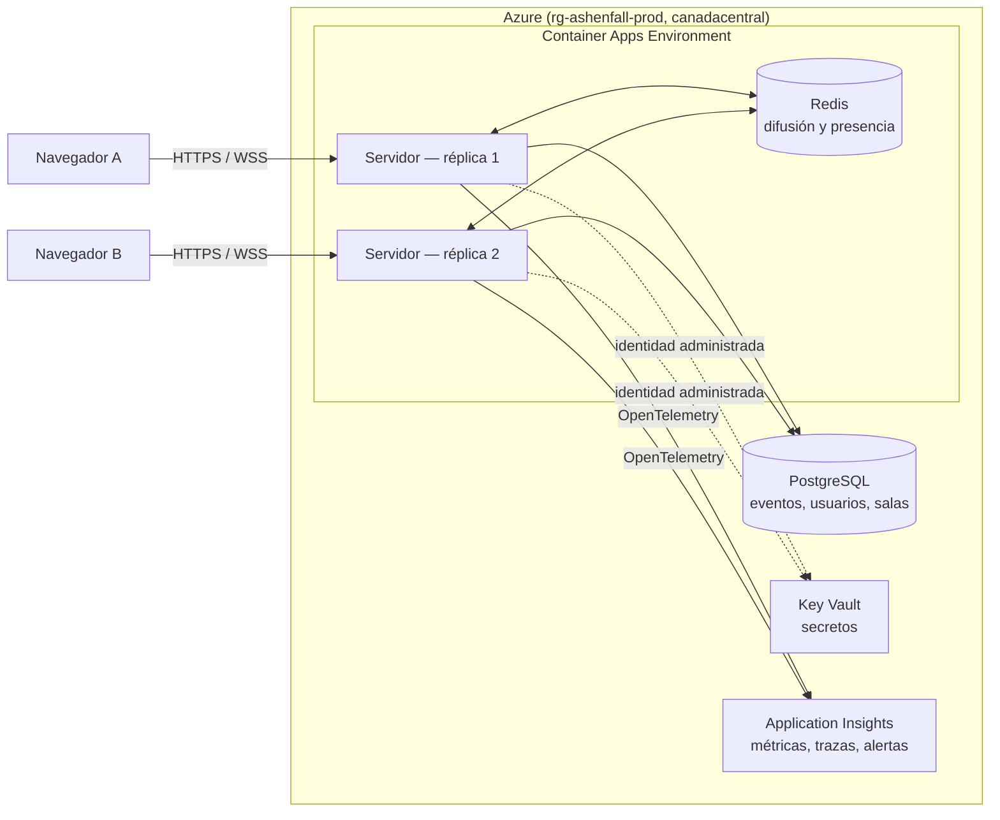

<p align="center">
  
</p>

<h1 align="center">ASHENFALL</h1>

<p align="center"><b>Servidor de nivel producción en Azure para un juego por turnos</b><br/><em>Apunta. Dispara. Sobrevive.</em></p>

<p align="center">
  <a href="https://ashenfall-server-prod.icytree-9cfd11e3.canadacentral.azurecontainerapps.io"><b>▶ Servidor en Azure</b></a>
  &nbsp;·&nbsp;
  <a href="https://ashenfall-server-prod.icytree-9cfd11e3.canadacentral.azurecontainerapps.io/docs">API (OpenAPI)</a>
  &nbsp;·&nbsp;
  <a href="entrega/Documentacion_ASHENFALL.pdf">Documentación en PDF</a>
  &nbsp;·&nbsp;
  <a href="#parte-2--el-juego">Jugar</a>
</p>

ASHENFALL es un **servidor autoritativo** que aloja muchas partidas simultáneas e independientes de un duelo 1v1 por turnos, y mantiene el estado de cada una consistente aunque los jugadores se desconecten, reintenten acciones o una instancia se reinicie. Está desplegado en Azure Container Apps y es el centro de este repositorio; el juego (con cliente web y arte) es el pretexto para ejercitarlo. Este README tiene dos partes:

1. **[El servidor](#parte-1--el-servidor)**: qué es, cómo está hecho, cómo se protege, cómo se despliega, cómo se mide y cómo se corre.
2. **[El juego](#parte-2--el-juego)**: la historia, cómo se juega y el enlace para probarlo.

El servidor está en **<https://ashenfall-server-prod.icytree-9cfd11e3.canadacentral.azurecontainerapps.io>** y la versión evaluada es la etiqueta **v1.0.0**.

---

# Parte 1 · El servidor

## De un vistazo

| Aspecto | Detalle |
|---|---|
| Lenguaje | TypeScript en modo estricto (sin `any`) sobre Node.js 22 |
| Servidor | Fastify 5; REST documentada con OpenAPI 3.1 en `/docs`; WebSocket seguro (`wss://`) documentado con AsyncAPI 3.0 |
| Datos | PostgreSQL 16 (log de eventos de cada partida) y Redis 7 (difusión entre réplicas, presencia y límites de tasa) |
| Dominio | Motor de reglas **puro** en `packages/domain`: sin red, base de datos ni framework |
| Azure | Container Apps (2 a 3 réplicas), PostgreSQL Flexible Server en red privada, Key Vault, Container Registry, Application Insights; región `canadacentral` |
| Identidad | Identidad administrada: ninguna clave ni cadena de conexión en la configuración; PostgreSQL con Microsoft Entra |
| Infraestructura | Bicep ([infra/](infra/)) y GitHub Actions con OIDC, sin secretos; prod con aprobación manual |
| Publicaciones | Revisiones con división de tráfico, drenado de conexiones y rollback de **22 s** (medido en producción) |
| Rendimiento | p95 de 15 ms o menos hasta 800 partidas en una réplica; quiebre en ~1 800 jugadas/s; 0 jugadas perdidas o duplicadas |
| Pruebas | 294 pruebas en 24 archivos (dominio, API, WebSocket, concurrencia, seguridad y resiliencia) en verde en CI |

## Cómo funciona

El cliente solo envía **intenciones** («disparar con este ángulo y esta potencia»). El servidor las valida contra las reglas y el estado actual, simula el resultado y guarda cada hecho como un **evento con número de secuencia** en PostgreSQL. El estado de una partida es siempre el resultado de reproducir sus eventos, así que cualquier réplica puede atenderla, la partida se puede reproducir jugada por jugada y un reinicio no pierde nada confirmado.



Más diagramas (capas, flujo de una jugada, ciclo de vida de una partida, modelo de datos) en [docs/arquitectura.md](docs/arquitectura.md).

## Seguridad

- **Autenticación:** JWT firmados (HS256, 15 minutos) con refresh token rotativo (reutilizar uno revoca la familia); contraseñas con **Argon2id**; el WebSocket se autentica en el handshake con un **ticket de un solo uso** de 30 segundos.
- **Autorización** en cada endpoint y mensaje: solo los participantes actúan en su partida, solo juega quien tiene el turno, solo el administrador usa `/v1/admin` y cada acción queda auditada.
- **Validación** de cada mensaje contra su esquema (tipos, rangos y 4 KiB máximo) antes de llegar al dominio; un mensaje inválido no cierra la partida.
- **Límites:** tasa por usuario e IP (HTTP 429 con `Retry-After`), 20 mensajes por segundo por conexión y 3 conexiones por usuario.
- **Vista por jugador:** el rival nunca recibe el ángulo, la potencia ni el `actionId` de una jugada, ni por WebSocket, ni por REST, ni en los logs.
- **Transporte:** solo HTTPS y WSS (HSTS, CSP, `nosniff`), CORS cerrado y orígenes del WebSocket restringidos.
- **Secretos:** en Key Vault, leídos con identidad administrada; ninguno en el repositorio.
- **Cadena de suministro:** Dependabot, CodeQL, gitleaks y Trivy en CI; la imagen corre como usuario no root.

Detalle completo, con los valores exactos, en [docs/seguridad.md](docs/seguridad.md) y el [modelo de amenazas](docs/threat-model.md). La política para reportar un problema está en [SECURITY.md](SECURITY.md).

## Sesiones y concurrencia

- **Orden por partida:** las jugadas de una partida se procesan una a una y cada evento lleva un `seq`; entre réplicas, la clave primaria `(match_id, seq)` deja confirmar a una sola.
- **Idempotencia:** cada jugada lleva un `actionId`; reenviarla devuelve un `ack` con `duplicate` y no se aplica dos veces.
- **Reconexión y abandono:** heartbeat, snapshot al reconectar y periodo de gracia de 60 s configurable; plazos de turno en PostgreSQL, barridos por todas las réplicas.
- **Durabilidad y aislamiento:** nada confirmado vive solo en memoria; un fallo en una partida no afecta a las demás.

## Azure y entrega continua

- **Infraestructura como código:** todos los recursos en [infra/main.bicep](infra/main.bicep); un ambiente nuevo se levanta con una sola ejecución del pipeline.
- **CI** ([.github/workflows](.github/workflows)): build, tipos, linter, 294 pruebas con PostgreSQL y Redis reales, validación de contratos, CodeQL, gitleaks y Trivy.
- **Despliegue** con OIDC y sin secretos: dev automático (cuando la suscripción lo permite) y **prod con aprobación manual**. La revisión nueva nace al 0 % del tráfico, se prueba y recibe el 100 %.
- **Rollback** con `scripts/rollback.sh`: 22 segundos en producción.
- **Observabilidad:** OpenTelemetry hacia Application Insights, logs con el id de partida y jugador, 4 métricas propias, sondas `/health/live` y `/health/ready` y 3 alertas.

Guía paso a paso y límites de la suscripción de estudiante en [docs/azure-setup.md](docs/azure-setup.md); costo estimado en [docs/azure-cost.md](docs/azure-cost.md).

## Rendimiento

El bot de [apps/bot](apps/bot) juega partidas reales y mide la latencia por jugada. En una réplica de 1 CPU: p95 de 15 ms o menos hasta 800 partidas simultáneas, unos 0,03 puntos de CPU y 0,02 MB por partida activa, y punto de quiebre cerca de 1 800 jugadas por segundo. En Azure, 3 corridas con partidas reales y una publicación de revisión en medio dieron 0 jugadas perdidas, 0 duplicadas y 0 errores. Resultados, optimizaciones con cifras antes y después y cómo reproducirlo: [docs/load-report.md](docs/load-report.md) y [docs/optimizacion.md](docs/optimizacion.md).

## Correr el servidor en local (menos de 10 minutos)
Solo necesitas Docker Desktop abierto; no hace falta Node ni configurar secretos.
```bash
git clone https://github.com/kevinmirandaa/ashenfall-game.git
cd ashenfall-game
docker compose up --build
```
Levanta PostgreSQL, Redis y el servidor, con las migraciones aplicadas. El servidor queda en http://localhost:8080, la API en http://localhost:8080/docs y las sondas en `/health/live` y `/health/ready`.

Para correr las pruebas (requiere Node 22):
```bash
npm ci
docker compose up -d --wait postgres redis
npm test
```
Más comandos (lint, tipos, carga, cuenta de administrador) en [docs/jugar-en-local.md](docs/jugar-en-local.md).

## Documentación del servidor

| Qué | Dónde |
|---|---|
| Documento de entrega en PDF (servidor, Azure, configuración, seguridad, rendimiento y cumplimiento del enunciado) | [entrega/Documentacion_ASHENFALL.pdf](entrega/Documentacion_ASHENFALL.pdf) |
| Arquitectura con diagramas | [docs/arquitectura.md](docs/arquitectura.md) |
| Seguridad y modelo de amenazas | [docs/seguridad.md](docs/seguridad.md) y [docs/threat-model.md](docs/threat-model.md) |
| Contratos | [contracts/openapi.json](contracts/openapi.json) (también en `/docs`) y [contracts/asyncapi.json](contracts/asyncapi.json) |
| Prueba de carga, punto de quiebre y optimizaciones | [docs/load-report.md](docs/load-report.md) y [docs/optimizacion.md](docs/optimizacion.md) |
| Azure: guía, costo y despliegue | [docs/azure-setup.md](docs/azure-setup.md) y [docs/azure-cost.md](docs/azure-cost.md) |
| Observabilidad | [docs/observability.md](docs/observability.md) |
| Cumplimiento del enunciado, punto por punto | [docs/cumplimiento-enunciado.md](docs/cumplimiento-enunciado.md) |
| Decisiones de arquitectura | [docs/DECISIONS.md](docs/DECISIONS.md) |
| Índice completo y cambios por ticket | [docs/README.md](docs/README.md) y [CHANGELOG.md](CHANGELOG.md) |

## Estructura del repositorio

```
SERVIDOR
packages/domain/   Motor de reglas puro: partida, física, turnos, arenas, vista por jugador y bot.
apps/server/       Fastify: REST, WebSocket, PostgreSQL (migraciones en migrations/), Redis, telemetría.
apps/bot/          Bots reproducibles: carga y punto de quiebre (load.ts) y publicación con partidas abiertas (redeploy.ts).
contracts/         OpenAPI 3.1 y AsyncAPI 3.0, generados desde el código.
infra/             Bicep del ambiente completo (Container Apps, PostgreSQL, Redis, Key Vault, ACR, alertas).
scripts/           Despliegue y rollback en Azure; generación de la documentación en PDF.
.github/           CI, despliegue dev/prod, CodeQL, gitleaks, escaneo de la imagen y Dependabot.
docs/              Toda la documentación: ver docs/README.md.
entrega/           Documentación en PDF para TEC Digital.

JUEGO
apps/client/       Cliente web de prueba (Phaser 3 y Vite), servido por el propio servidor.
scripts/build-*.py Generación del arte del cliente a partir de references/ (no versionadas).
```

---

# Parte 2 · El juego

Duelo 1v1 por turnos de proyectiles, de fantasía oscura y pixel art, que se juega en el navegador contra otra persona o contra monstruos. **Juega aquí:** <https://ashenfall-server-prod.icytree-9cfd11e3.canadacentral.azurecontainerapps.io>. Solo hace falta crear una cuenta. Una guía con capturas está en [docs/guia-de-juego.md](docs/guia-de-juego.md).

## La historia

Hace siglos, el mundo quedó dividido por un acontecimiento conocido como **La Caída de las Cenizas**.

Desde entonces, las antiguas tierras dejaron de ser seguras. Criaturas que habitaban las profundidades comenzaron a aparecer en los bosques, las montañas y los pueblos abandonados.

Los reinos cayeron. Los caminos quedaron desiertos. Y los pocos que todavía se atrevían a recorrerlos terminaron convirtiéndose en cazadores, mercenarios o monstruos.

En medio de ese mundo existe **Ashenfall**, un pequeño asentamiento comercial donde todavía se reúnen guerreros de todas las regiones.

Allí se reparan armas, se intercambian reliquias y se aceptan desafíos.

Porque en estas tierras, la supervivencia tiene un precio. Y la gloria pertenece a quien consigue regresar.

## Cómo jugar

### El objetivo
Cada duelo enfrenta a dos mercenarios en una arena. Se turnan para disparar; quien deja al rival sin vida gana. Cada uno empieza con **100 puntos de vida**, el turno dura **30 segundos** y el duelo tiene como máximo **12 rondas**. Si se acaban las rondas, gana quien conserve más vida, y con la misma vida hay empate.

Nadie se mueve por su cuenta: cada jugador aparece en un punto de la arena y se queda ahí. Solo se desplaza cuando lo impactan: **retrocede según el daño recibido y no vuelve**. No hay viento.

### Disparar
1. **Mantén pulsado** el botón del ratón y **arrastra hacia atrás**, como una tirachinas. Cuanto más lejos arrastras, más fuerza.
2. **Sube o baja** el ratón para elegir el ángulo. Una guía de puntos cortos muestra el tiro con la **potencia y el ángulo en porcentaje**.
3. **Suelta** para disparar. Con **Esc** cancelas el apuntado sin disparar.

La cámara empieza en tu personaje, se desplaza hasta el rival para que estimes la distancia y luego sigue cada disparo hasta donde cae. Ambos jugadores ven lo mismo. Los obstáculos de la arena (muros, árboles, plataformas, gradas y colinas) frenan los proyectiles, y cambian en cada partida.

Si se acaba tu tiempo, pierdes el turno sin daño; dos tiempos agotados seguidos se cuentan como abandono.

### El pueblo
Tras entrar, llegas a Ashenfall. Todo se maneja desde ahí:
- **Barra inferior** (se puede arrastrar): **Personajes** para elegir con quién pelear, **Jugar** para empezar un duelo y **Perfil** para ver tu nivel y tus estadísticas.
- **Arsenal** (el edificio de la izquierda): aquí se compran personajes nuevos.
- **Historial** (abajo a la izquierda): tus partidas anteriores.
- **Ajustes** (arriba a la derecha): volumen y el correo para reportar problemas.

### Modos de juego
- **Buscar partida**: te empareja con otro jugador que también esté buscando. Espera como máximo un minuto.
- **Partida privada**: crea una sala, comparte el código con un amigo y empiecen cuando ambos estén listos.
- **Modo historia**: diez monstruos en orden, movidos por el servidor. Cada victoria desbloquea al siguiente y el premio crece de 50 a 350 Marcas de Ceniza.

En el móvil se juega **en horizontal**: en vertical aparece un aviso para girar el dispositivo. El apuntado es el mismo, con el dedo en vez del ratón.

Para probar un duelo entre humanos tú solo, abre el juego en dos navegadores (o en una ventana normal y otra privada) y entra con una cuenta distinta en cada uno.

### Progreso
- Ganar un duelo da **100 Marcas de Ceniza**; perder o empatar no da nada.
- Cada partida suma experiencia (10 por partida, 30 más por victoria; 80 por nivel, hasta el nivel 20).
- Empiezas con **Edrik**. Los otros nueve personajes se compran en el Arsenal con nivel y Marcas. Cada uno usa siempre su propia arma.
- Hay siete arenas: aldea en ruinas, cementerio, desierto, pinar con niebla, puente helado, fortaleza carmesí y ruinas brumosas.
