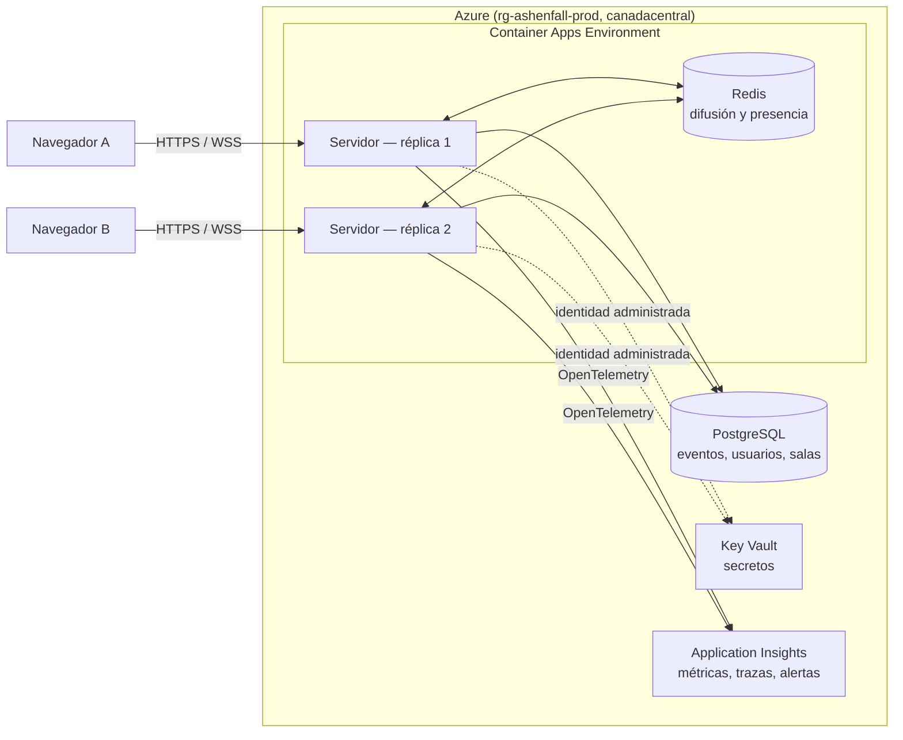

<p align="center">
  
</p>

<h1 align="center">ASHENFALL</h1>

<p align="center"><b>Servidor de nivel producción en Azure para un juego por turnos</b></p>

<p align="center">
  <a href="https://github.com/kevinmirandaa/ashenfall-game/actions/workflows/ci.yml"></a>
  <a href="https://github.com/kevinmirandaa/ashenfall-game/actions/workflows/codeql.yml"></a>
  <a href="https://github.com/kevinmirandaa/ashenfall-game/actions/workflows/gitleaks.yml"></a>
  <a href="https://github.com/kevinmirandaa/ashenfall-game/actions/workflows/image-scan.yml"></a>
</p>

<p align="center">
  <a href="https://ashenfall-server-prod.icytree-9cfd11e3.canadacentral.azurecontainerapps.io"><b>▶ Servidor en Azure</b></a> ·
  <a href="https://ashenfall-server-prod.icytree-9cfd11e3.canadacentral.azurecontainerapps.io/docs">API (OpenAPI)</a> ·
  <a href="entrega/Documentacion_ASHENFALL.pdf">Documentación en PDF</a> ·
  <a href="#el-juego">El juego</a>
</p>

> **El juego es el pretexto; lo que se construyó y se evalúa es el servidor.** ASHENFALL es un servidor autoritativo que aloja muchas partidas simultáneas de un duelo 1v1 por turnos y mantiene el estado de cada una consistente aunque los jugadores se desconecten, reintenten acciones o una instancia se reinicie. Versión evaluada: etiqueta **v1.0.0**.

## Guía rápida para el profesor

| Qué busca | Dónde verlo |
|---|---|
| Servidor funcionando | [https://ashenfall-server-prod.icytree-9cfd11e3.canadacentral.azurecontainerapps.io](https://ashenfall-server-prod.icytree-9cfd11e3.canadacentral.azurecontainerapps.io) · [/docs](https://ashenfall-server-prod.icytree-9cfd11e3.canadacentral.azurecontainerapps.io/docs) · [/health/ready](https://ashenfall-server-prod.icytree-9cfd11e3.canadacentral.azurecontainerapps.io/health/ready) |
| Documentación de entrega (PDF) | [entrega/Documentacion_ASHENFALL.pdf](entrega/Documentacion_ASHENFALL.pdf) |
| Cumplimiento del enunciado, punto por punto | [docs/cumplimiento-enunciado.md](docs/cumplimiento-enunciado.md) |
| Correr el servidor en local | [Más abajo](#correr-el-servidor-en-local-en-menos-de-10-minutos) |

Y por cada criterio de la rúbrica:

| Criterio | Dónde verlo |
|---|---|
| Arquitectura y calidad de construcción (20 %) | Dominio puro en [packages/domain](packages/domain) · [docs/arquitectura.md](docs/arquitectura.md) |
| Sesiones y concurrencia (20 %) | [apps/server/src/matches](apps/server/src/matches) y [realtime](apps/server/src/realtime) · pruebas `resilience.test.ts` y `gateway.test.ts` |
| Seguridad (20 %) | [docs/seguridad.md](docs/seguridad.md) · [docs/threat-model.md](docs/threat-model.md) · [SECURITY.md](SECURITY.md) |
| Rendimiento y optimización (15 %) | [docs/load-report.md](docs/load-report.md) · [docs/optimizacion.md](docs/optimizacion.md) · bot en [apps/bot](apps/bot) |
| Despliegue en Azure, IaC y CI/CD (10 %) | [infra/](infra/) · [.github/workflows](.github/workflows) · [scripts/](scripts/) · [docs/azure-setup.md](docs/azure-setup.md) |
| Estándares, contratos y pruebas (10 %) | [contracts/openapi.json](contracts/openapi.json) · [contracts/asyncapi.json](contracts/asyncapi.json) · 294 pruebas en CI |
| Documentación y observabilidad (5 %) | [docs/](docs/README.md) · [docs/observability.md](docs/observability.md) |

---

## El servidor en un minuto

- **Autoritativo:** el cliente solo envía intenciones (ángulo y potencia); el servidor las valida, simula el tiro y decide el resultado.
- **Event sourcing:** cada partida es un registro de eventos con número de secuencia en PostgreSQL; se reproduce jugada por jugada y sobrevive a reinicios.
- **Varias réplicas:** Redis reparte los eventos entre réplicas y la clave `(match_id, seq)` deja confirmar una sola jugada a la vez.
- **Dominio puro:** el motor de reglas no conoce red, base de datos ni framework ([packages/domain](packages/domain)).
- **Stack:** TypeScript estricto (sin `any`), Node 22, Fastify, WebSocket seguro, PostgreSQL 16 y Redis 7.



Más diagramas (capas, flujo de una jugada, ciclo de una partida, datos) en [docs/arquitectura.md](docs/arquitectura.md).

## Seguridad

- **Autenticación:** JWT de 15 minutos con refresh token rotativo, contraseñas con Argon2id y WebSocket con ticket de un solo uso.
- **Autorización** en cada endpoint y mensaje: participantes de la partida, jugador en turno y administrador, con auditoría.
- **Validación y límites:** cada mensaje se valida contra su esquema; límites de tasa (HTTP 429 con `Retry-After`), de tamaño y de conexiones por usuario.
- **Sin filtración:** el rival nunca recibe el ángulo, la potencia ni el `actionId` de una jugada.
- **Transporte y secretos:** solo HTTPS y WSS, CORS cerrado, secretos en Key Vault con identidad administrada y ninguno en el repositorio.
- **Cadena de suministro:** Dependabot, CodeQL, gitleaks y Trivy en CI; imagen sin usuario root.

Detalle con los valores exactos: [docs/seguridad.md](docs/seguridad.md).

## Azure y entrega continua

- Toda la infraestructura está en **Bicep** ([infra/main.bicep](infra/main.bicep)) y un ambiente nuevo se levanta con una sola ejecución del pipeline.
- **GitHub Actions** con inicio de sesión OIDC (sin secretos): CI en cada pull request y despliegue con **aprobación manual para producción**.
- **Publicaciones sin cortar partidas:** la revisión nueva nace al 0 % del tráfico, se prueba y recibe el 100 %; la anterior queda lista para el **rollback (22 s medidos en producción)**.
- **Observabilidad:** OpenTelemetry hacia Application Insights, logs con el id de partida, métricas propias, sondas y 3 alertas ([docs/observability.md](docs/observability.md)).

## Rendimiento

En una réplica de 1 CPU: **p95 de 15 ms o menos hasta 800 partidas simultáneas**, sin jugadas perdidas ni duplicadas, y punto de quiebre cerca de 1 800 jugadas por segundo. En Azure, tres corridas con partidas reales (una de ellas durante una publicación) dieron 0 jugadas perdidas, 0 duplicadas y 0 errores. Resultados y cómo reproducirlos: [docs/load-report.md](docs/load-report.md).

## Correr el servidor en local (en menos de 10 minutos)

Solo hace falta Docker Desktop abierto.

```bash
git clone https://github.com/kevinmirandaa/ashenfall-game.git
cd ashenfall-game
docker compose up --build
```

Queda en http://localhost:8080, con la API en http://localhost:8080/docs y las sondas en `/health/live` y `/health/ready`.

Para correr las pruebas (Node 22):

```bash
npm ci
docker compose up -d --wait postgres redis
npm test
```

Más comandos (lint, carga, cuenta de administrador): [docs/jugar-en-local.md](docs/jugar-en-local.md).

## Estructura del repositorio

```
SERVIDOR
packages/domain/   Motor de reglas puro (partida, física, turnos, vista por jugador, bot)
apps/server/       Fastify: REST, WebSocket, PostgreSQL (migraciones), Redis, telemetría
apps/bot/          Bots de carga (load.ts) y de publicación con partidas abiertas (redeploy.ts)
contracts/         OpenAPI 3.1 y AsyncAPI 3.0, generados desde el código
infra/             Bicep: Container Apps, PostgreSQL, Redis, Key Vault, ACR, alertas
scripts/           Despliegue y rollback en Azure; generador del PDF
.github/           CI, despliegue dev/prod, CodeQL, gitleaks, escaneo de imagen, Dependabot
docs/              Documentación (índice en docs/README.md)
entrega/           Documentación en PDF para TEC Digital

JUEGO
apps/client/       Cliente web de prueba (Phaser 3 y Vite), servido por el propio servidor
```

---

## El juego

Duelo 1v1 por turnos de proyectiles, de fantasía oscura, que se juega en el navegador contra otra persona o contra monstruos. **Juega aquí:** <https://ashenfall-server-prod.icytree-9cfd11e3.canadacentral.azurecontainerapps.io> (solo hace falta crear una cuenta). Guía con capturas: [docs/guia-de-juego.md](docs/guia-de-juego.md).

**En resumen:** cada jugador empieza con 100 puntos de vida, el turno dura 30 segundos y hay 12 rondas como máximo. Se dispara **manteniendo pulsado y arrastrando hacia atrás**, como una tirachinas, y soltando. Nadie se mueve: solo se retrocede al recibir un impacto. Se puede jugar en **Buscar partida** (contra otra persona), **Partida privada** (con un código para un amigo) y **Modo historia** (diez monstruos). Ganar da 100 Marcas de Ceniza para comprar personajes en el Arsenal. En el móvil se juega en horizontal.

<details>
<summary><b>La historia de Ashenfall</b></summary>

Hace siglos, el mundo quedó dividido por un acontecimiento conocido como **La Caída de las Cenizas**.

Desde entonces, las antiguas tierras dejaron de ser seguras. Criaturas que habitaban las profundidades comenzaron a aparecer en los bosques, las montañas y los pueblos abandonados.

Los reinos cayeron. Los caminos quedaron desiertos. Y los pocos que todavía se atrevían a recorrerlos terminaron convirtiéndose en cazadores, mercenarios o monstruos.

En medio de ese mundo existe **Ashenfall**, un pequeño asentamiento comercial donde todavía se reúnen guerreros de todas las regiones.

Allí se reparan armas, se intercambian reliquias y se aceptan desafíos.

Porque en estas tierras, la supervivencia tiene un precio. Y la gloria pertenece a quien consigue regresar.

</details>

<details>
<summary><b>Cómo se juega, paso a paso</b></summary>

1. **Mantén pulsado** el botón del ratón y **arrastra hacia atrás**: cuanto más lejos, más fuerza. Sube o baja el ratón para elegir el ángulo; una guía de puntos muestra la potencia y el ángulo en porcentaje.
2. **Suelta** para disparar. Con **Esc** cancelas el apuntado.
3. La cámara empieza en tu personaje, pasa por el rival para estimar la distancia y sigue cada disparo. Los obstáculos de la arena frenan los proyectiles y cambian en cada partida.
4. Si se acaba tu tiempo, pierdes el turno; dos tiempos agotados seguidos cuentan como abandono. Si se acaban las 12 rondas, gana quien tenga más vida.
5. Ganar da 100 Marcas de Ceniza (perder o empatar, nada); cada partida suma experiencia y se sube de nivel hasta el 20. Empiezas con Edrik y compras otros nueve personajes en el Arsenal con nivel y Marcas.
6. Para probar un duelo entre humanos tú solo, abre el juego en dos navegadores con una cuenta distinta en cada uno.

</details>
