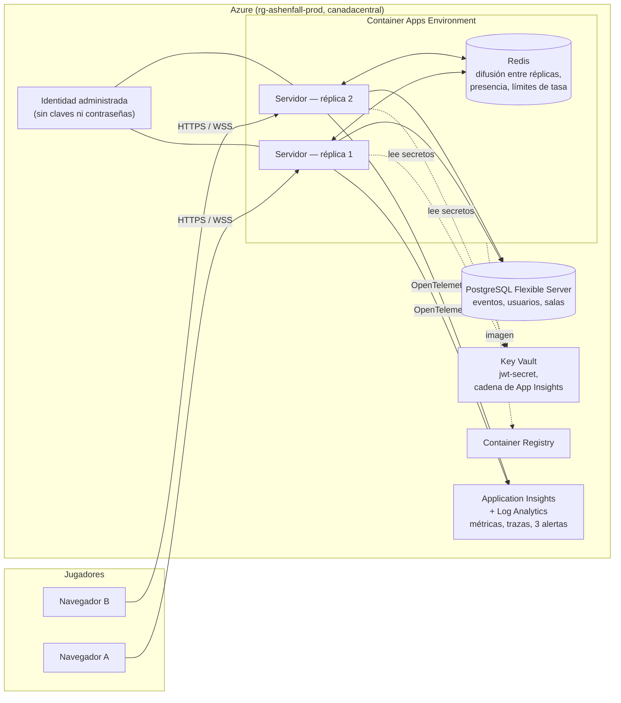
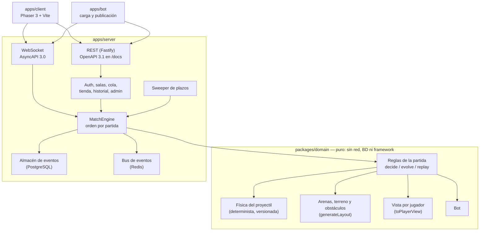
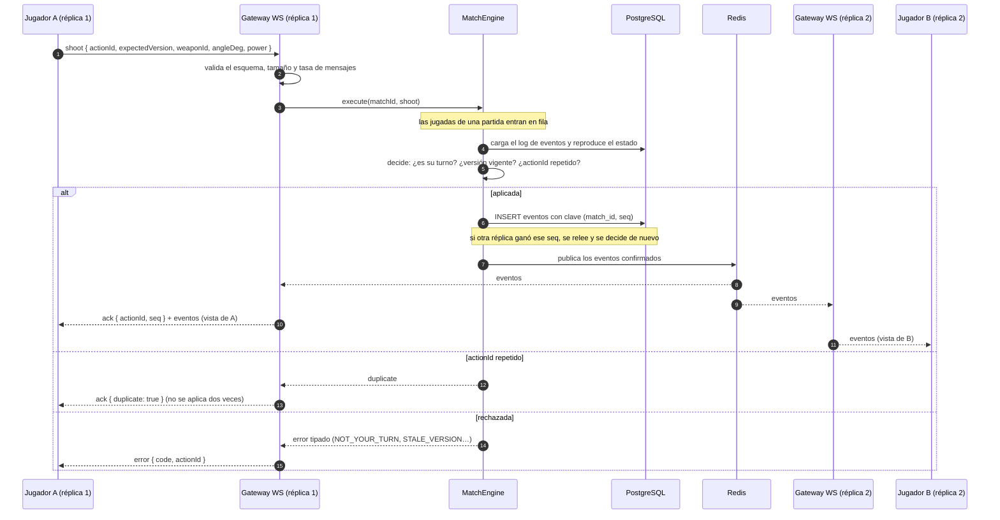
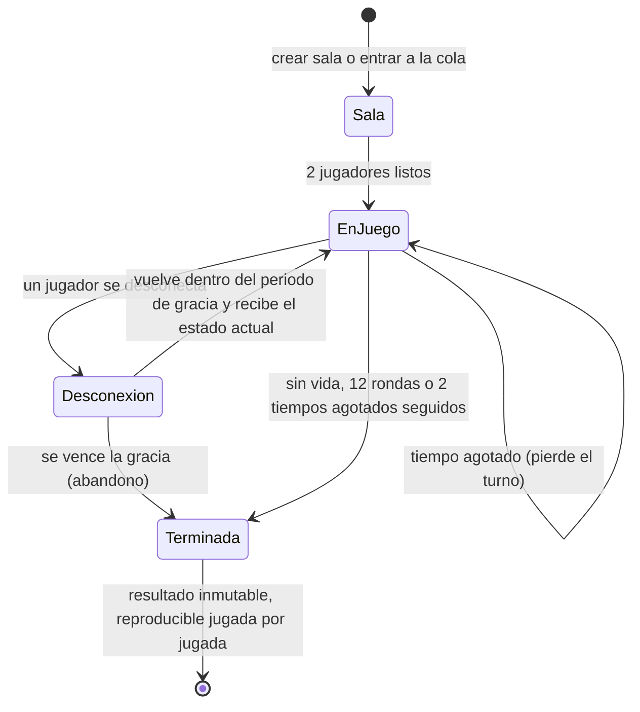
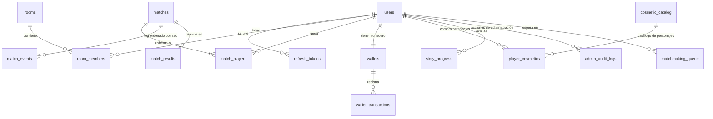

# Arquitectura de ASHENFALL

Visión general del servidor, con diagramas. Las decisiones y sus motivos están en [DECISIONS.md](DECISIONS.md); las amenazas, en [threat-model.md](threat-model.md); cómo se cumple cada requisito del enunciado, en [cumplimiento-enunciado.md](cumplimiento-enunciado.md).

**Idea central:** el servidor es la única fuente de verdad. El cliente solo envía intenciones («disparar con este ángulo y esta potencia»); el servidor las valida contra las reglas y el estado actual, simula el tiro, decide el daño y guarda cada hecho como un evento con número de secuencia. El estado de una partida es siempre el resultado de **reproducir sus eventos**, así que cualquier réplica puede atenderla y un reinicio no pierde nada confirmado.

## 1. Topología en Azure

- Los jugadores entran por HTTPS y WSS a **cualquier réplica**; el ingress rechaza HTTP.
- **PostgreSQL** guarda lo que no se puede perder: el log de eventos de cada partida, usuarios, salas, historial y compras. Se entra con identidad de Microsoft Entra (`passwordAuth` desactivado).
- **Redis** guarda lo efímero: difunde a todas las réplicas los eventos ya confirmados, lleva la presencia de cada usuario y los contadores de límite de tasa. Si Redis pierde un mensaje, el cliente nota el hueco en `seq` y pide el estado con `sync`.
- **Key Vault** guarda el secreto de los JWT; la app lo lee con su identidad administrada. No hay secretos en el repositorio ni en texto plano en la configuración.
- Todo está en Bicep ([infra/main.bicep](../infra/main.bicep)) y se despliega con GitHub Actions ([deploy.yml](../.github/workflows/deploy.yml)): dev automático (cuando la suscripción lo permite) y prod con aprobación manual.

## 2. Capas del código

La regla de dependencias va en un solo sentido: el servidor conoce al dominio y el dominio no conoce a nadie. ESLint lo hace cumplir (el dominio no puede importar red, base de datos, reloj ni azar globales), y las pruebas del dominio corren sin ninguna dependencia externa. El azar sale de una `RandomSource` que el servidor inyecta, criptográficamente segura.

## 3. Qué pasa cuando alguien dispara

Cómo se cumplen las reglas del enunciado en este flujo:

| Regla | Mecanismo |
|---|---|
| Servidor autoritativo | El cliente manda ángulo y potencia, nunca resultados; el dominio simula y decide. |
| Orden por partida | Fila por partida en cada réplica; entre réplicas, la clave primaria `(match_id, seq)` deja confirmar a una sola y la otra relee. |
| Versión vieja rechazada | `expectedVersion` frente a la versión del estado: `STALE_VERSION`. |
| Idempotencia | El `actionId` del cliente se guarda en el evento; reenviarlo devuelve `ack` con `duplicate: true`. |
| Vista por jugador | Cada evento se proyecta a la vista de su destinatario; el rival nunca recibe el ángulo, la potencia ni el `actionId`. |
| Durabilidad | El estado se reconstruye desde PostgreSQL; nada confirmado vive solo en memoria. |
| Aislamiento | Un fallo en una partida no bloquea la fila de otra ni tumba el proceso. |

## 4. Ciclo de vida de una partida

- **Plazos:** el siguiente plazo de cada partida está en PostgreSQL (`matches.next_deadline_ms`) y todas las réplicas barren los vencidos ([sweeper.ts](../apps/server/src/matches/sweeper.ts)). No hay réplica líder: si dos barren a la vez, el dominio rechaza el comando repetido y `(match_id, seq)` deja confirmar uno. Por eso un reinicio no pierde temporizadores.
- **Conexión:** heartbeat ping/pong, ticket de un solo uso para entrar por WSS, y códigos de cierre documentados (1001 cierre ordenado, 4003 suspendido, 4008 demasiadas conexiones, 4009 sin heartbeat, 4029 límite de tasa).
- **Limpieza:** las partidas abandonadas o inactivas expiran por los plazos; las salas sin iniciar se cierran a la hora; la cola filtra por `expires_at`.
- **Fin:** el resultado se guarda una vez y no cambia; `GET /v1/matches/{id}/replay` devuelve la partida jugada por jugada, solo a sus participantes.

## 5. Modelo de datos

`player_cosmetics` y `cosmetic_catalog` conservan su nombre original aunque hoy solo contienen personajes: el brief inicial vendía cosméticos y la decisión de la versión estable fue vender personajes, sin renombrar tablas ya migradas.

## 6. Seguridad en capas

| Capa | Defensa |
|---|---|
| Identidad | Contraseñas con Argon2id; JWT de 15 minutos con refresh token rotativo; el JWT se firma con un secreto de Key Vault. |
| WebSocket | Ticket de un solo uso y corta duración; sin ticket válido se cierra; origen restringido. |
| Autorización | Solo los participantes actúan en su partida; solo juega quien tiene el turno; solo el rol administrador usa `/v1/admin` y cada acción queda auditada. |
| Validación | Cada mensaje entrante se valida contra su esquema (tipos, rangos y tamaño) antes de llegar al dominio; uno inválido no cierra la partida. |
| Límites | Tasa por IP y por usuario (HTTP 429 con `Retry-After`), tasa por conexión, tamaño máximo de mensaje y máximo de conexiones por usuario. |
| Transporte | Solo HTTPS y WSS, CORS cerrado, encabezados de seguridad (HSTS, CSP, `nosniff`). |
| Cadena de suministro | Dependabot, CodeQL, gitleaks y Trivy en CI; imagen sin usuario root. |

El detalle de cada amenaza, su defensa y su prueba está en [threat-model.md](threat-model.md).

## 7. Observabilidad

- **Métricas propias** (OpenTelemetry → Application Insights): `ashenfall.matches.active`, `ashenfall.connections`, `ashenfall.shots` (jugadas por segundo al consultar) y `ashenfall.shot.latency`, la latencia de cada jugada desde que llega hasta repartirla.
- **Trazas:** un span por comando (`match.shoot`, `match.turn_timeout`, `match.player_disconnected`…) con `ashenfall.match_id` y `ashenfall.player_id`.
- **Logs** estructurados con el id de la partida y del jugador, sin datos sensibles, y con el id de traza para cruzarlos.
- **Sondas** `/health/live` y `/health/ready`, y 3 alertas (reinicios, CPU de PostgreSQL y latencia).

Más detalle en [observability.md](observability.md).
