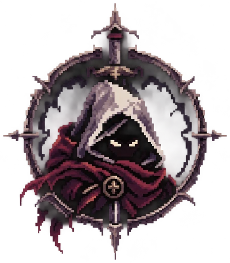
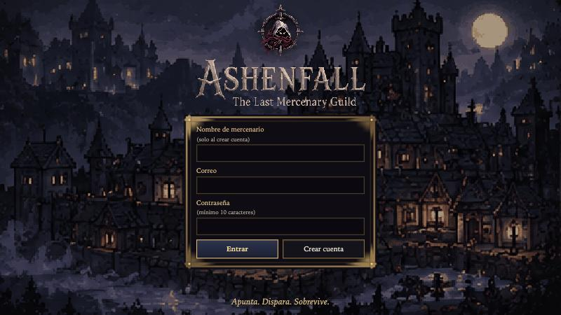
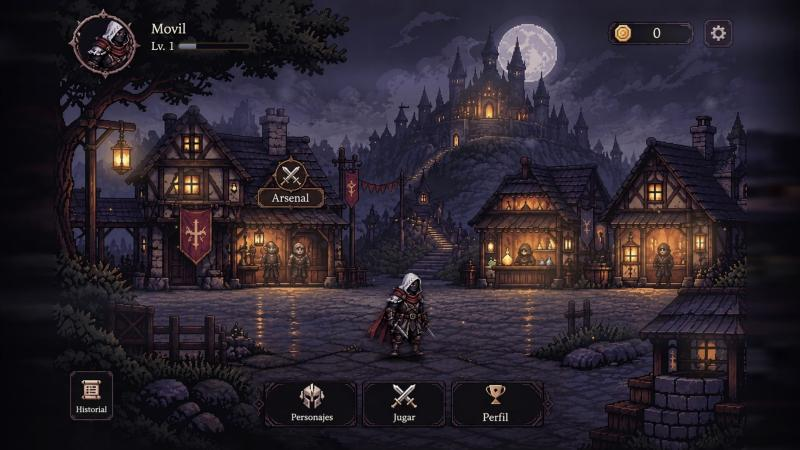
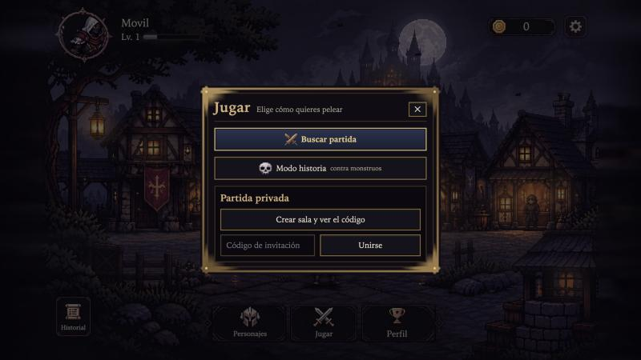
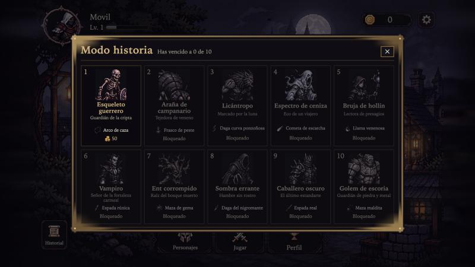
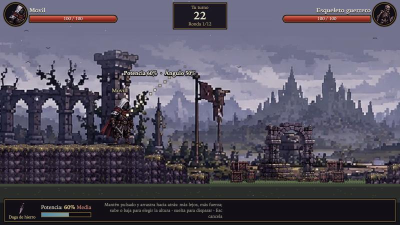
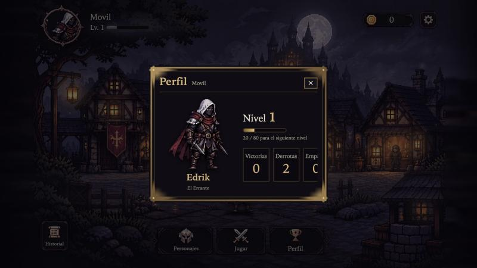
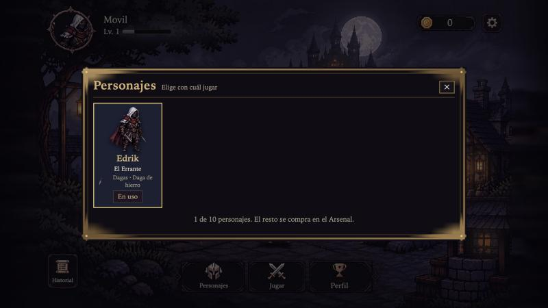
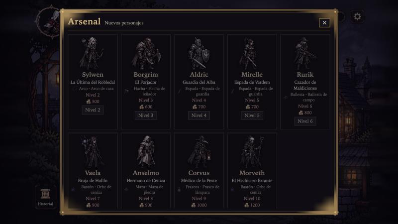
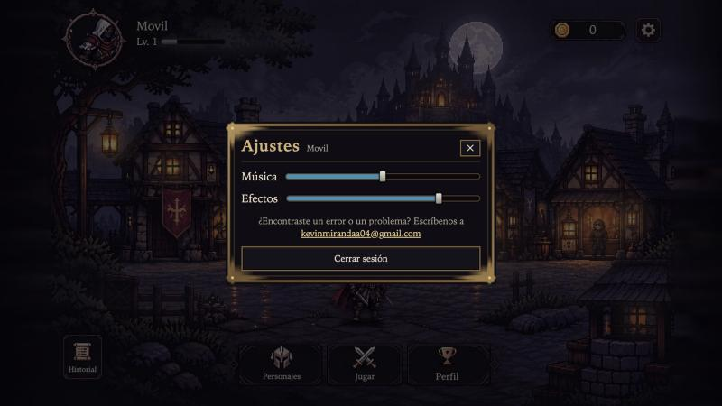

# Guía de juego de ASHENFALL

Una guía paso a paso, con capturas del juego real, para quien nunca lo ha jugado. Para la historia del mundo, mira el [README](../README.md); para correrlo en tu equipo, [jugar-en-local.md](jugar-en-local.md).

**Qué necesitas:** un navegador. En el móvil se juega en **horizontal** (si lo sostienes en vertical, el juego te pide girarlo). No hay que instalar nada.

## 1. Crear una cuenta y entrar
Abre el enlace del juego. En la pantalla de acceso escribe tu correo y una contraseña de al menos 10 caracteres. Para estrenar la cuenta pulsa **Crear cuenta** (puedes ponerle un nombre de mercenario); si ya la tienes, pulsa **Entrar**.

## 2. El pueblo
Al entrar llegas a **Ashenfall**. Arriba a la izquierda ves tu mercenario con su nivel y su experiencia; arriba a la derecha, tus **Marcas de Ceniza** (el dinero del juego) y los **ajustes**.

- **Barra inferior**: **Personajes**, **Jugar** y **Perfil**. Se puede arrastrar para moverla si tapa algo.
- **Arsenal** (el edificio de la izquierda, se ilumina al pasar el ratón): la tienda de personajes.
- **Historial** (abajo a la izquierda): tus últimas partidas y su resultado.

## 3. Elegir cómo pelear
Pulsa **Jugar**. Hay tres caminos:

| Modo | Cómo funciona |
|---|---|
| **Buscar partida** | Te empareja con otra persona que también esté buscando. Espera como máximo un minuto. |
| **Modo historia** | Un duelo contra un monstruo que mueve el servidor. |
| **Partida privada** | **Crear sala** te da un código de invitación para compartir; tu amigo lo escribe en **Código de invitación** y pulsa **Unirse**. Empieza cuando ambos marcan que están listos. |

### Modo historia
Son diez monstruos, en orden. Vences al primero para desbloquear al segundo, y así hasta el último. Cada uno usa su propia arma y el premio crece de 50 a 350 Marcas.

## 4. El duelo
Cada duelo se juega en una arena que cambia en cada partida: hay siete (aldea en ruinas, cementerio, desierto, pinar con niebla, puente helado, fortaleza carmesí y ruinas brumosas) y el servidor sortea el terreno (llano, plataformas con gradas o una colina) y los obstáculos.

**Lo que ves en pantalla**
- Arriba a los lados, la vida de cada uno (100 al empezar).
- Arriba al centro, de quién es el turno, los segundos que quedan (30 por turno) y la ronda (máximo 12).
- Abajo, tu arma y la **potencia** del disparo.

**Cómo se dispara** (estilo tirachinas)
1. **Mantén pulsado** el botón del ratón (o el dedo en una pantalla táctil).
2. **Arrastra hacia atrás**, lejos de tu rival: cuanto más lejos, más fuerza. Subir o bajar el cursor cambia la altura del tiro.
3. Una guía de puntos te muestra la trayectoria, con la **potencia** y el **ángulo** en porcentaje.
4. **Suelta** para disparar. Con **Esc** o con clic derecho cancelas el apuntado.

**Reglas que conviene saber**
- Nadie se mueve a voluntad: cada jugador aparece en un punto de la arena y se queda ahí. Solo se desplaza cuando lo impactan: **retrocede según el daño y no vuelve**.
- No hay viento. Los obstáculos (muros, árboles, plataformas, gradas, colinas) frenan los proyectiles.
- La cámara empieza en ti, pasa por el rival para que estimes la distancia y después sigue a quien dispara y a cada proyectil. Ambos jugadores ven lo mismo.
- Si se agota tu tiempo, **pierdes el turno** sin daño. Dos turnos seguidos agotados cuentan como **abandono** y pierdes el duelo.
- Si te desconectas, tienes **un minuto** para volver: la partida sigue en el servidor y, al reconectar, recibes su estado actual. Si no vuelves a tiempo, cuenta como abandono.
- Gana quien deja al rival sin vida. Si se acaban las 12 rondas, gana quien conserve más vida; con la misma vida, es empate.

## 5. Premios, nivel y personajes
- **Ganar** da **100 Marcas de Ceniza**; perder o empatar no da nada (en el modo historia el premio es el de cada monstruo).
- Cada partida suma experiencia: 10 por jugar y 30 más por ganar. Cada nivel pide 80 de experiencia, hasta el nivel 20.
- Tu **Perfil** muestra el personaje, el nivel, la barra de experiencia y tus victorias, derrotas y empates.

Empiezas con **Edrik, el Errante**. En **Personajes** eliges con cuál pelear; cada uno usa siempre su arma.

En el **Arsenal** compras los otros nueve. Cada uno pide un nivel mínimo (el botón de cada tarjeta lo muestra) y un precio en Marcas de Ceniza.

| Personaje | Arma | Nivel | Precio |
|---|---|---:|---:|
| Sylwen, la Última del Robledal | Arco de caza | 2 | 500 |
| Borgrim, el Forjador | Hacha de leñador | 3 | 600 |
| Aldric, Guardia del Alba | Espada de guardia | 4 | 700 |
| Mirelle, Espada de Vardem | Espada de guardia | 5 | 700 |
| Rurik, Cazador de Maldiciones | Ballesta de campo | 6 | 800 |
| Vaela, Bruja de Hollín | Orbe de ceniza | 7 | 900 |
| Anselmo, Hermano de Ceniza | Maza de piedra | 8 | 900 |
| Corvus, Médico de la Peste | Frasco de lámpara | 9 | 1 000 |
| Morveth, el Hechicero Errante | Orbe de ceniza | 10 | 1 200 |

## 6. Ajustes
La rueda de arriba a la derecha abre los ajustes: el volumen de la **música** y de los **efectos**, el correo para reportar un error y **Cerrar sesión**.

## Preguntas frecuentes
**¿Puedo jugar solo?** Sí, con el modo historia. Para probar un duelo entre personas tú solo, abre el juego en dos navegadores (o en una ventana normal y otra privada) con una cuenta distinta en cada uno.

**¿Se pierde mi partida si cierro la pestaña?** No de inmediato. La partida vive en el servidor: vuelve a entrar con tu cuenta dentro del minuto de gracia y la retomas con su estado actual (si era tu turno, el reloj sigue corriendo).

**¿Por qué mi disparo no sale?** Revisa que sea tu turno y que arrastres **hacia atrás**, lejos de tu rival. Si arrastras hacia él, el disparo no se arma.
